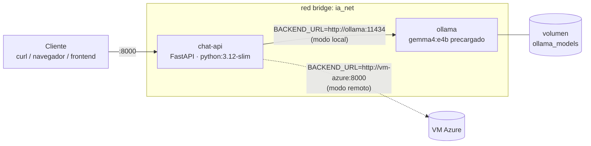

# Reto 07/10 · Contenerización del chat con Docker

Team MIRA · Inetum · 7 de octubre de 2026 · Perfil **ASIX**

Stack Docker con **Ollama + Gemma 4 E4B** y una **API FastAPI** que se conecta a Ollama en local o a la VM de Azure cambiando solo una variable de entorno.

📘 **Conceptos de Docker para el equipo** (imágenes, contenedores, volúmenes, redes y Compose): [`docs/DOCKER_CONCEPTOS.md`](docs/DOCKER_CONCEPTOS.md)

## Arquitectura



```
reto-07-10/
├── docker-compose.yml     # stack: ollama (perfil local) + api
├── .env.example           # BACKEND_URL, MODEL, BACKEND_API_KEY, API_PORT
├── api/
│   ├── Dockerfile         # imagen de la API (también incluye el chat CLI)
│   ├── app.py             # FastAPI: /health, /modelos, /chat
│   ├── backend.py         # cliente común con API compatible con OpenAI (Ollama y Azure)
│   └── chat_cli.py        # chat por consola del reto 06/10
├── ollama/
│   ├── Dockerfile         # ollama/ollama + entrypoint
│   └── entrypoint.sh      # descarga el modelo si no está en el volumen
└── docs/DOCKER_CONCEPTOS.md
```

## Requisitos

- **Docker Desktop**. Para comprobar la instalación:
  ```bash
  docker --version         # Docker version 29.8.1
  docker run hello-world   # "Hello from Docker!"
  ```
- Unos **10 GB de disco** para la imagen de Ollama y el modelo.
- **8 GB de RAM asignados a Docker** (Docker Desktop → Settings → Resources). Si no hay tanta memoria, usa `MODEL=gemma4:e2b`.

## Despliegue

### Modo local (Ollama en contenedor)

```bash
cp .env.example .env
docker compose --profile local up -d --build
```

La **primera vez**, el contenedor `ollama` descarga `gemma4:e4b` (6,6 GB) en el volumen `ollama_models`. La API espera a que termine gracias al `healthcheck`:

```bash
docker compose logs -f ollama     # "Descargando gemma4:e4b (solo la primera vez)..."
```

Las siguientes veces arranca al momento: «Modelo gemma4:e4b ya presente en el volumen».

### Modo remoto (VM de Azure)

Edita `.env`:

```env
BACKEND_URL=http://<ip-o-dominio-vm>:8000
MODEL=<modelo-desplegado-en-la-vm>
BACKEND_API_KEY=<clave>
```

Y levanta **solo la API**, sin el perfil `local`, así Ollama no arranca:

```bash
docker compose up -d --build api
```

> Para volver a local, restaura `BACKEND_URL=http://ollama:11434` y usa `docker compose --profile local up -d`.

## Uso de la API

| Endpoint | Descripción |
|---|---|
| `GET /health` | Estado de la API, backend activo (`local`/`remoto`), URL y modelos disponibles |
| `GET /modelos` | Modelos del backend |
| `POST /chat` | `{"prompt": "..."}` o `{"mensajes": [{"role":"user","content":"..."}]}` |
| `GET /docs` | Swagger UI generado por FastAPI |

```bash
curl localhost:8000/health
curl localhost:8000/chat -H 'Content-Type: application/json' \
     -d '{"prompt": "Explica en una frase qué es un volumen Docker"}'
```

Chat por consola dentro del contenedor (el script del reto anterior):

```bash
docker compose run --rm api python chat_cli.py
```

## Configuración ASIX

| Aspecto | Implementación |
|---|---|
| **Red** | `ia_net` (bridge). La API llega a Ollama por DNS interno (`http://ollama:11434`). **Ollama no publica puertos al host**: solo es accesible desde la red interna |
| **Variables de entorno** | `BACKEND_URL` (local/remoto), `MODEL`, `BACKEND_API_KEY` y `API_PORT`, con valores por defecto `${VAR:-...}` y leídas de `.env` (ignorado por git) |
| **Volumen persistente** | `ollama_models` → `/root/.ollama`. El modelo sobrevive a `down`/`up` y a cambios de imagen |
| **Orden de arranque** | `healthcheck` de Ollama (modelo presente) + `depends_on: service_healthy`, con `required: false` para el modo remoto |
| **Perfiles** | `ollama` en el perfil `local`: en remoto no consume recursos |
| **Seguridad de la imagen** | `python:3.12-slim`, usuario sin privilegios (`appuser`), `.dockerignore`, sin secretos en la imagen |
| **Resiliencia** | `restart: unless-stopped` y `HEALTHCHECK` en la imagen de la API |

## Verificación realizada

| Prueba | Resultado |
|---|---|
| `docker run hello-world` | ✅ |
| `docker compose --profile local up -d --build` | ✅ Descarga el modelo, Ollama queda *healthy* y la API arranca |
| `GET /health` en local | ✅ `{"backend":"local","backend_ok":true,"modelos_disponibles":["gemma4:e4b"]}` |
| `POST /chat` en local | ✅ Responde correctamente (~24 s en frío por la carga del modelo y ~1,5 s después en un prompt corto) |
| Persistencia (`down` + `up`) | ✅ «Modelo gemma4:e4b ya presente en el volumen», sin volver a descargar |
| Cambio a remoto con `BACKEND_URL` | ✅ Solo arranca `chat-api`, `/health` devuelve `"backend":"remoto"` y `/chat` responde. Probado contra un servidor simulado con API compatible con OpenAI en el host, porque la VM de Azure aún no está disponible |

> **Rendimiento:** en macOS, Docker no tiene acceso a la GPU de Apple Silicon, así que Ollama en el contenedor funciona solo con CPU (~6 tok/s frente a ~23 tok/s del Ollama nativo con Metal). En un host Linux con GPU NVIDIA se puede añadir `deploy.resources.reservations.devices` con `driver: nvidia` al servicio `ollama`.

## Fuera del alcance (perfil DAW/DAM)

El tercer contenedor con frontend web/móvil corresponde a los perfiles DAW/DAM. Puede añadirse como un servicio más en `ia_net` que consuma `http://chat-api:8000/chat`.
