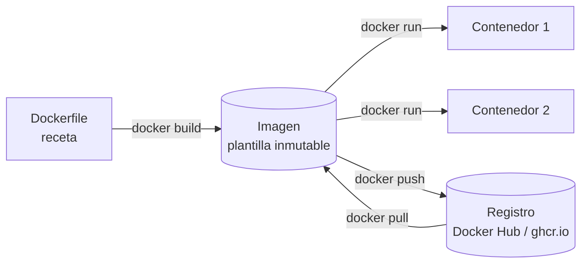
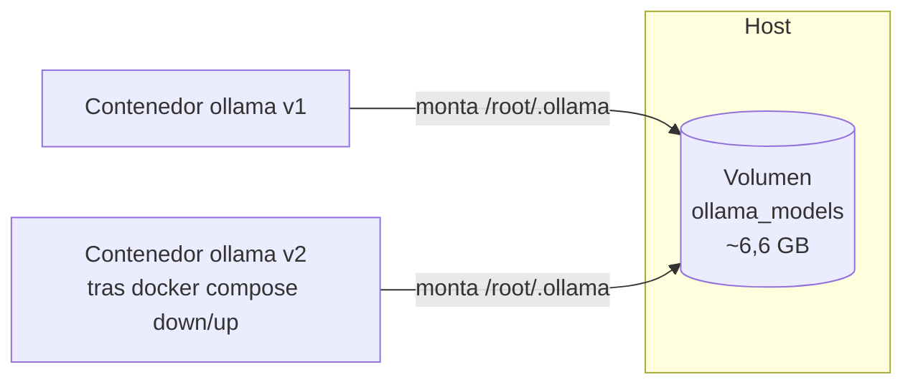
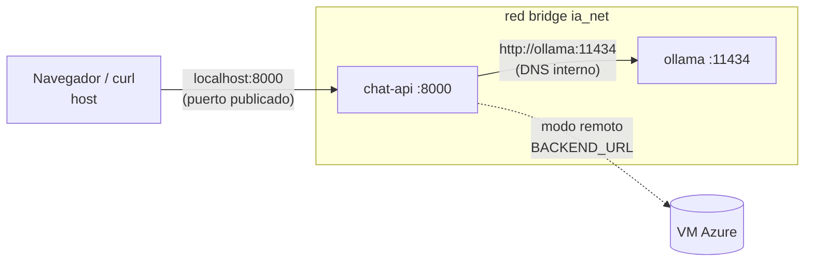

# Docker para el equipo: conceptos clave

> Material preparado por el perfil ASIX para explicar Docker a los compañeros · Reto 07/10

## La idea en una frase

Docker empaqueta una aplicación **con todo lo que necesita** (código, librerías, sistema base) para que funcione igual en cualquier máquina. Se acabó el «en mi ordenador funciona».



---

## 1. Imágenes

Una **imagen** es una plantilla de **solo lectura**: un sistema de archivos con la aplicación y sus dependencias, construido por **capas**.

```
┌──────────────────────────────┐
│ COPY *.py .                  │ ← capa 4: cambia a menudo (nuestro código)
├──────────────────────────────┤
│ RUN pip install ...          │ ← capa 3: dependencias (en caché si no cambian)
├──────────────────────────────┤
│ COPY requirements.txt .      │ ← capa 2
├──────────────────────────────┤
│ python:3.12-slim             │ ← capa 1: imagen base (Debian + Python)
└──────────────────────────────┘
```

- Se crean con un **Dockerfile** (`docker build`) o se descargan de un registro (`docker pull`).
- **Buena práctica:** poner primero lo que cambia poco y al final lo que cambia mucho. Así Docker reutiliza las capas en caché y las reconstrucciones tardan segundos. Es lo que hace nuestro [`api/Dockerfile`](../api/Dockerfile).

| Comando | Para qué sirve |
|---|---|
| `docker build -t chat-api ./api` | Construir una imagen |
| `docker images` | Listar imágenes locales |
| `docker pull ollama/ollama` | Descargar una imagen del registro |

## 2. Contenedores

Un **contenedor** es una **instancia en ejecución** de una imagen: la imagen más una capa de escritura y un proceso aislado.

| Máquina virtual | Contenedor |
|---|---|
| Incluye un sistema operativo completo (GB) | Comparte el kernel del host (MB) |
| Arranca en minutos | Arranca en segundos |
| Aislamiento fuerte (hipervisor) | Aislamiento con *namespaces* y *cgroups* |

- Son **efímeros**: al borrar el contenedor se pierde todo lo que haya escrito, salvo lo que esté en un **volumen**.
- Si la imagen es una clase, el contenedor es un objeto: de una imagen se pueden lanzar muchos contenedores.

| Comando | Para qué sirve |
|---|---|
| `docker run -d -p 8000:8000 chat-api` | Crear y arrancar un contenedor |
| `docker ps` / `docker ps -a` | Ver los contenedores activos o todos |
| `docker logs -f chat-api` | Ver los logs |
| `docker exec -it ollama sh` | Abrir una shell dentro del contenedor |
| `docker stop` / `docker rm` | Parar o eliminar un contenedor |

## 3. Volúmenes

Los **volúmenes** guardan datos **fuera** del ciclo de vida del contenedor.



| Tipo | Ejemplo | Uso |
|---|---|---|
| **Volumen con nombre** | `ollama_models:/root/.ollama` | Datos de la aplicación (BD, modelos). Los gestiona Docker. ✅ Es el que usamos |
| **Bind mount** | `./config:/app/config` | Montar una carpeta del host (desarrollo, configuración) |
| **tmpfs** | `tmpfs: /tmp` | Datos temporales en RAM |

**En nuestro stack:** el modelo Gemma 4 E4B (6,6 GB) se descarga **una sola vez**. Con `docker compose down` y `up`, el log muestra «Modelo gemma4:e4b ya presente en el volumen».

| Comando | Para qué sirve |
|---|---|
| `docker volume ls` | Listar volúmenes |
| `docker volume inspect ollama_models` | Ver dónde está y su configuración |
| `docker compose down -v` | ⚠️ Borra también los volúmenes (y el modelo) |

## 4. Redes

Docker crea redes virtuales para que los contenedores hablen entre sí **por nombre**.



| Driver | Descripción |
|---|---|
| **bridge** | Red privada en el host. En redes definidas por el usuario, los contenedores se resuelven por nombre (DNS). ✅ La que usamos |
| **host** | El contenedor usa directamente la red del host (sin aislamiento) |
| **none** | Sin red |
| **overlay** | Red entre varios hosts (Swarm) |

**Decisiones de seguridad del stack:**
- `ollama` **no publica puertos** al host. Solo la API puede llegar a él a través de `ia_net`. Así se reduce la superficie de ataque.
- Solo `chat-api` publica el puerto `8000`.
- `ports: "8000:8000"` significa *puerto del host : puerto del contenedor*.

| Comando | Para qué sirve |
|---|---|
| `docker network ls` | Listar redes |
| `docker network inspect ia_net` | Ver los contenedores conectados y sus IPs |

## 5. Docker Compose

Compose define **varios contenedores, redes y volúmenes en un solo YAML** y los levanta con un comando.

```yaml
services:     # contenedores
  api:
    build: ./api                  # imagen a partir de un Dockerfile
    environment: { BACKEND_URL: ... }  # configuración por variables
    ports: ["8000:8000"]
    depends_on: { ollama: { condition: service_healthy } }
networks: { ia_net: {} }
volumes: { ollama_models: {} }
```

Conceptos que usamos en [`docker-compose.yml`](../docker-compose.yml):

| Concepto | Para qué |
|---|---|
| `profiles: ["local"]` | Ollama solo arranca con `--profile local`. En modo remoto no se levanta |
| `healthcheck` | Ollama se considera «sano» solo cuando el modelo ya está descargado |
| `depends_on: condition: service_healthy` | La API espera a que el modelo esté listo |
| `required: false` | Si Ollama no existe (modo remoto), la API arranca igualmente |
| `${VAR:-valor}` | Variables de entorno con valor por defecto, leídas de `.env` |
| `restart: unless-stopped` | Reinicio automático si el proceso cae |

## Chuleta final

```bash
docker compose --profile local up -d --build   # levantar
docker compose ps                              # estado
docker compose logs -f api                     # logs
docker compose --profile local down            # parar (conserva volúmenes)
docker system df                               # espacio usado
```
